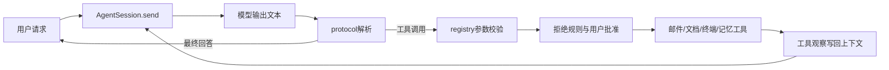

# CS329Z Agent Harness · 个人学习记录

基于 Stanford CS329Z《Engineering AI Agents》HW1 的 AI 辅助学习实现：从提示词流水线开始，逐步构建检索、工具调用、会话循环、记忆与人工确认。**这是个人学习仓库，与 Stanford 官方无隶属关系。**

**当前状态：P1–P14 有实现；P15 有历史评测结果；P16 field notes、P17 design memo 尚未完成。** 本仓库公开展示学习快照。课程完整答案的公开规则未得到明确确认，不能把AI使用许可或上游MIT自动解读成学生解答公开许可。

**离线核验：282通过、4跳过、0失败。** 4项都是依赖未分发真实邮件档案的BM25测试；没有运行live模型测试或P15模拟评测。这证明脚本化接口行为，不证明真实模型答题质量、沙箱安全或课程得分。[详细证据](reports/local-deterministic-summary.json) · [审查及已知问题](AUDIT.md)

## 先看什么

**初学者，约20分钟：** 先读下方数据流，再看 [P1分类](hw1/cs329z_hw1/pipelines/priority.py)、[P3检索](hw1/cs329z_hw1/pipelines/bm25.py)，最后跟着 [session.send](hw1/cs329z_hw1/agent/session.py) 看一次“模型输出→工具执行→把结果交回模型”。不知道一个对象的含义时查 [types.py](hw1/cs329z_hw1/types.py)，用 [test_agent_loop.py](hw1/tests/test_agent_loop.py) 中的脚本化例子理解循环，不必先配置API。

**工程师深读：** `types.py → adapters.py → registry.py → protocol.py → session.py`；随后检查 `cardinal_tools.py` 如何组装工具，比较 `email_qa.py` 两种检索策略，再读 `docs.py / terminal.py / memory.py / guards.py`。将每个模块与对应 `test_*.py` 对照；最后阅读课程 `sandbox.py` 的隔离边界和 [AUDIT.md](AUDIT.md) 的失败模式。历史设计日志可选，里面的分数是历史记录，不是新增复测结论。

## 实际目录

以下是当前目录的主要层级；`…`仅省略已有的同类文件，未表示待实现结构。完整逐文件列表见 [FILE_INDEX.md](FILE_INDEX.md)。

```text
.
├── README.md                 # 本预览的主入口
├── AUDIT.md                  # 核验口径、风险和改进项
├── SOURCES_AND_LICENSES.md   # 上游来源、归属和公开政策边界
├── FILE_INDEX.md             # 实际文件清单及来源分类
├── PUBLICATION_CHECKLIST.md  # 本次public检查与剩余事项
├── tools/
│   ├── audit_offline.py      # 本轮整理：禁止真实LM/网络的测试入口
│   └── audit-requirements.txt
├── reports/                  # 本轮离线JUnit、摘要和来源核验
└── hw1/
    ├── README.md             # 当前实现的运行说明入口
    ├── UPSTREAM_README.md    # 原课程starter说明，保留供对照
    ├── LICENSE              # 官方MIT版权全文
    ├── pyproject.toml / uv.lock / .env.example
    ├── cs329z_hw1/
    │   ├── types.py / adapters.py
    │   ├── pipelines/       # priority、digest、BM25、email QA、docs
    │   ├── agent/           # registry、protocol、session、tools等
    │   ├── llm.py / backends.py
    │   ├── sandbox.py / sandbox_windows.py
    │   ├── chat.py / show.py / user.py / data.py / cardinal.py
    │   ├── tokenizer.py / tokens.py
    │   └── simulation/      # 官方persona、judge和评测runner
    ├── tests/               # 官方测试及部分公开fixtures
    ├── data/                # 24份虚构公司文档、规范、来源及下载脚本
    ├── notes/design_log.md  # 原Claude工作区的设计过程记录
    ├── score.py             # 原实现附加的本地分数估算工具
    └── CHANGELOG.md
```

## 模块如何协作



`adapters.py`是官方测试与实现之间的薄连接层；`registry.py`管工具的schema、参数和异常，`protocol.py`管文本格式，`session.py`管循环及预算。`cardinal_tools.py`把各流水线封装成工具。这样可以替换检索或模型入口，而不重写测试接口。

设计取舍也有代价：JSON协议容易检查，但需要处理模型格式错误；BM25透明便宜，但依赖关键词；迭代检索能利用中间结果，但增加模型轮数；压缩和记忆节省上下文，但可能损失事实。会话循环目前同时负责压缩、批准与防护，适合按课程顺序阅读，长期维护可进一步拆分；这轮没有为排版而重构它。

## 从零安装与离线测试

需要 Python 3.11+。先进入本目录，创建独立环境；以下命令适用于macOS/Linux：

```sh
python3 -m venv .venv
.venv/bin/python -m pip install -r tools/audit-requirements.txt
.venv/bin/python tools/audit_offline.py
```

Windows的Python路径为 `.venv\Scripts\python.exe`。依赖安装需要网络；安装完成后，上述测试入口本身不需要API key、订阅CLI、邮件档案或网络。它忽略 `.env`、禁止真实LM构造与调用、关闭第三方pytest插件自动加载，并拒绝本Python进程的网络连接；子进程仅来自已检查的官方确定性终端测试。**这不是运行任意不可信测试代码的通用安全容器。**

报告写到 `reports/latest-offline-junit.xml`；临时测试目录自动创建并清理。结果应为282通过、4跳过。4个跳过项是 `test_archive_build_time`、`test_archive_recall_at_10`、`test_archive_results_are_sorted`、`test_archive_query_time`。`test_sim_eval.py`整体未运行，live测试也未运行；它们不计入这4个skip。

如果只想查看单元测试本身，可阅读 `hw1/tests/`。不要把上游README里的默认全量测试/评测命令直接当成此精简公开版本的完整复现步骤。

## 模型配置：可选，先理解费用与权限

离线阅读与测试无需本节。要实际聊天，先安装 [uv](https://docs.astral.sh/uv/getting-started/installation/)，然后：

```sh
cd hw1
uv sync --frozen
cp .env.example .env
```

在本机编辑 `.env`，填入自己的 `OPENROUTER_API_KEY`，可设置 `CS329Z_BUDGET_USD`。**不要提交.env；真实模型调用可能收费，缓存和账本应保留在本机。** 配置项以 `.env.example` 和 `llm.py` 为准。

原实现也提供 `CS329Z_BACKEND=claude` 或 `codex`，要求相应CLI自行安装并登录。CLI会加入自己的系统提示词，模型行为和课程评分模型不等同；read-only不代表禁用全部工具，ledger的0美元也不代表无订阅额度消耗。本轮没有重新调用这些后端。

本版本可读取虚构公司文档；邮件能力需要另取官方档案。确认终端隔离与费用后才运行 `uv run python -m cs329z_hw1.chat --mode confirm`。**confirm会约束写工具，但读工具可能自动执行，不能代替OS隔离。** 本轮未验证新的真实聊天流程。

## 题目到源码

路径均相对 `hw1/cs329z_hw1/`；全部通过 `adapters.py`接入。

|题目|主要入口|说明|
|---|---|---|
|P1|`pipelines/priority.py`|邮件分类和JSON解析|
|P2|`pipelines/digest.py`|分类后生成紧急邮件摘要|
|P3|`pipelines/bm25.py`|倒排索引及评分|
|P4|`pipelines/email_qa.py`|规划/迭代多跳检索|
|P5|`agent/registry.py`|工具schema、校验和执行|
|P6|`agent/protocol.py`|工具调用文本协议|
|P7|`agent/session.py`|主循环、停止状态和预算|
|P8|`agent/cardinal_tools.py`|公司助手工具组装|
|P9|`pipelines/docs.py`|公司文档切块、检索和读取|
|P10|`agent/terminal.py`|终端观察和大输出处理|
|P11|`agent/session.py`|上下文压缩和pin|
|P12|`agent/memory.py`|持久记忆及修正|
|P13|`agent/session.py`、`cardinal_tools.py`|批准、steering、澄清|
|P14|`agent/guards.py`、`session.py`|拒绝规则及启发式防注入|
|P15|`simulation/`|官方harness；历史18/20，未本轮重跑|
|P16/P17|尚无正式文件|field notes/design memo未完成|

## 数据、安全与已排除内容

公开目录含虚构Cardinal公司文档；原课程邮件档案是**真实Enron邮件**，不是合成数据。本版本不分发档案、含全文的priority_gold、含历史地址的3个fixture、私人会话/记忆、模型缓存、视频或原git补丁。缺失清单见 [PUBLICATION_CHECKLIST.md](PUBLICATION_CHECKLIST.md)。

因此精简版本不能完整复现live邮件题或20-persona模拟基准。不要直接跑余下18份persona并把结果叫“完整P15”。需要完整本地评测时，从[固定官方commit](https://github.com/cs329z/assignment1-harness/tree/c6cab03d161e4e8db8a9e2c12caf8e353b079beb)另取缺失数据，保留在私有工作副本中，不纳入公开提交。`data/download.py`在这里没有压缩档可解包，单独运行它不能替代取回档案。

终端隔离不可用时课程sandbox会回退none；防注入仅逐字匹配部分工具输出，CHECK_B已关闭；记忆修正和摘要也可能出错。请勿把它接到重要文件、私人数据或生产系统。具体代码局限见 [AUDIT.md](AUDIT.md)。

## 谁写了什么

- **官方starter：** 类型、LM封装、sandbox、数据加载、公司工具schema、chat/show/user、simulation、测试、数据资料、依赖及原README。上游MIT全文与归属保留。
- **原Claude辅助实现：** `pipelines/`、`agent/`的算法与行为、`adapters.py`接线；`backends.py`、`llm.py`的订阅后端hook、`score.py`和设计日志。源码及日志记录了一些用户选择，但无法独立确认逐行作者或每项决策归属，不能自称全部手写。
- **本轮整理：** 根目录说明、阅读路线、源码/来源审查、脱敏发布清单、离线测试工具和证据。没有改变上述作业算法，也没有把目录重排成新架构。用户新增实现及本轮整理工具采用MIT许可，见根目录LICENSE；上游MIT及原版权归属保留于hw1/LICENSE。

官方基准 `c6cab03d161e4e8db8a9e2c12caf8e353b079beb`；恢复实现 `d5d6a41693b872ea518f3a9a76fc85ad6e531eb0`。本预览不含原.git历史。更多来源与政策核查见 [SOURCES_AND_LICENSES.md](SOURCES_AND_LICENSES.md)。
